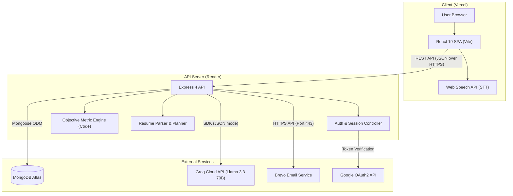
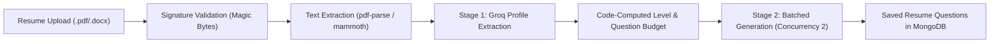

# AI Mock Interview Coach

> An interactive interview practice platform providing real-time voice and typed evaluations, code-computed pacing and filler-word metrics, and structured STAR feedback powered by Groq.

[](client/package.json)
[](server/package.json)
[](server/package.json)
[](server/package.json)
[](client/package.json)
[](client/package.json)
[](server/services/groqService.js)
[](vercel.json)
[](server/server.js)

- **Live Application:** https://ai-mock-interview-coach-rho.vercel.app/ <!-- TODO: verify - replace with your live deployment URL -->

---

## Table of Contents

- [Why I Built This](#why-i-built-this)
- [Features](#features)
- [How It Works](#how-it-works)
- [Tech Stack](#tech-stack)
- [Engineering Highlights](#engineering-highlights)
- [Getting Started (Local)](#getting-started-local)
- [Environment Variables](#environment-variables)
- [API Overview](#api-overview)
- [Project Structure](#project-structure)
- [Security Notes](#security-notes)
- [Audio and Privacy](#audio-and-privacy)
- [Deployment](#deployment)
- [Known Limitations](#known-limitations)
- [Roadmap](#roadmap)
- [Author and License](#author-and-license)

---

## Why I Built This

I built this project because practicing interview responses alone in an empty room gives you zero actionable signal on whether your answers are actually landing. Most self-practice involves reciting notes without noticing filler words, pacing drift, or omitted outcomes. This tool provides an objective mirror: it computes your speaking rate and filler count directly in code, extracts exact quotes from your transcript to verify each stage of the STAR framework (Situation, Task, Action, Result), and suggests a concrete restructured answer for your next attempt.

---

## Features

### Practice and Feedback
- **Dual Input Modes:** Practice by speaking out loud via the browser's Web Speech API or switch to manual typing mode if you are in a quiet environment or on an unsupported browser.
- **STAR Framework Evaluation:** Evaluates answers across Situation, Task, Action, and Result, awarding each a 0–10 score with detected/missing status badges and direct evidence quotes pulled from your transcript.
- **Actionable Guidance:** Returns targeted strengths ("What You Did Well"), prioritized improvements ("What to Improve"), and a complete "Stronger Version" restructure (or an exemplary benchmark answer if the input is off-topic).
- **Code-Computed Speech Metrics:** Calculates speaking pace in Words Per Minute (WPM), speech duration, exact filler-word counts (`um`, `uh`, `like`, `basically`, `actually`, `literally`, `you know`, `sort of`, `kind of`, `i mean`), and a calibrated filler score (10 minus 1.5 per 100 words).
- **Live STAR Cues:** Real-time visual pill badges light up during active recording when structural anchor words are detected in speech.

### Resume-Tailored Questions
- **Two-Stage Analysis:** Upload a PDF or Word (.docx) resume to extract role titles, work experience, projects, evidenced skills, listed skills, and gap areas.
- **Experience Level Detection:** Maps candidate profiles to `fresher`, `junior`, `mid`, or `senior` tiers using verified years of experience and role histories.
- **Targeted Question Sets:** Generates behavioral, technical-lite, and situational questions anchored directly to specific lines and achievements on your resume.
- **Question Management:** Switch between the built-in Question Bank and your custom resume question sets, with search and filtering by category or difficulty (`Basic`, `Intermediate`, `Advanced`).

### Accounts and Security
- **Authentication:** Standard email and password authentication with bcrypt hashing, email verification via 6-digit OTPs, and password reset workflows.
- **Google OAuth 2.0:** One-tap and OAuth credential sign-in verifying Google ID tokens or access tokens directly against Google API endpoints.
- **Session Revocation:** Incremental token versioning (`tokenVersion`) inside JWT payloads invalidates all active sessions upon password reset.
- **Data Privacy & Account Deletion:** Full cascade account deletion (`DELETE /api/auth/account`) removes user records, past sessions, resumes, generated questions, and authentication tokens in a single transaction.

### UX and Design
- **Warm Editorial Theme:** Styled using a custom Tailwind palette featuring warm paper (`#FAF6EE`), forest green accents (`#2F5233`), and terracotta alerts (`#C2572B`).
- **Dark Mode Support:** Toggle between Warm Paper (light) and Warm Ink (dark) modes with smooth layout animations.
- **Optimistic Deletions with Undo:** Deleting past sessions or resume sets updates the UI immediately and provides a 6-second toast with an "Undo" action before issuing backend deletions.
- **Responsive Layout:** Adaptive desktop sidebar layout and a compact mobile bottom navigation bar (`MobileBottomNav`).

---

## How It Works

1. **Question Selection:** The user selects a question from the curated Question Bank or generates a customized set by uploading their resume.
2. **Answer Capture:** The candidate speaks their response aloud (transcribed in real time via the browser's Web Speech API) or types it manually.
3. **Metric Calculation:** The Express backend receives the transcript and audio duration, immediately computing word count, duration, WPM, and filler-word frequencies in deterministic JavaScript code.
4. **LLM Evaluation:** The backend feeds the transcript, question metadata, resume context, and precomputed metrics into Groq (`llama-3.3-70b-versatile`) in JSON mode.
5. **Session Recording:** The server validates and saves the evaluation breakdown to MongoDB Atlas, and the React client displays radial score gauges, evidence quotes, and model answers.

### Architecture Overview



### Resume Analysis Pipeline



---

## Tech Stack

| Layer | Technology | Version | Purpose in Codebase |
| :--- | :--- | :--- | :--- |
| **Frontend Framework** | React | `^19.2.8` | Component rendering, state management, and real-time UI updates |
| **Routing** | React Router | `^7.18.4` | Single-page client navigation and URL query synchronization |
| **Styling** | Tailwind CSS | `^3.4.19` | Utility-first styling with custom warm paper and dark palette tokens |
| **Animations** | Framer Motion | `^14.0.0` | Micro-interactions, gauge animations, and page transitions |
| **Icons** | Lucide React | `^1.48.0` | Accessible iconography across the studio and navigation |
| **Build Tool** | Vite | `^8.3.0` | Fast development server and production client bundling |
| **Backend Runtime** | Node.js | `>=18.11.0` | JavaScript server runtime supporting native watch mode |
| **Server Framework** | Express | `^4.21.2` | REST API routing, error handling, and middleware integration |
| **Database** | MongoDB / Mongoose | `^8.9.5` | Document persistence for users, questions, resumes, and sessions |
| **LLM Inference** | Groq SDK | `^0.15.0` | Low-latency inference via `llama-3.3-70b-versatile` in JSON mode |
| **Security & Headers** | Helmet | `^8.3.0` | HTTP response header hardening and information disclosure defense |
| **Authentication** | JSON Web Tokens | `^9.0.3` | Signed bearer token authentication with token version checking |
| **Password Hashing** | bcryptjs | `^3.0.3` | Salted password hashing and comparison routines |
| **Rate Limiting** | express-rate-limit | `^8.7.1` | Per-IP throttling across public authentication and contact routes |
| **Schema Validation** | Zod | `^4.6.5` | Request body, query, and parameter schema enforcement |
| **Document Parsing** | pdf-parse / mammoth | `^2.4.5` / `^1.13.0` | In-memory text extraction from uploaded PDF and DOCX files |
| **Archive Inspection** | adm-zip | `^0.6.1` | Validation of DOCX magic signatures (`word/document.xml`) |
| **Email Delivery** | Brevo HTTPS / Nodemailer | `^10.1.0` | Transactional email dispatch via HTTPS REST API and SMTP fallback |

---

## Engineering Highlights

- **Two-Stage Resume Pipeline with Code-Computed Budget:** Document parsing and structural profile analysis (Stage 1) are decoupled from question synthesis (Stage 2). The system calculates an exact question allocation (clamped between 10 and 40 questions) in deterministic JavaScript using resume entity counts rather than asking an LLM to perform arithmetic.
- **Deterministic Metrics Computed in Code:** Words Per Minute (WPM), speech duration, exact filler occurrences (via regular expressions covering 10 distinct filler phrases), and an inverse filler score are calculated in Node.js before invoking the LLM, eliminating hallucinated speech statistics.
- **Resilient JSON-Mode LLM Orchestration:** Evaluates responses and generates question batches using Groq's JSON mode (`response_format: { type: 'json_object' }`), featuring automatic model fallback (`llama-3.3-70b-versatile` to `openai/gpt-oss-120b`), concurrency-limited execution queues, and exponential backoff parsing upstream `retry-after` headers.
- **Multi-Tiered Rate Limiting and Quota Defense:** Combines IP-level sliding windows on public authentication routes with in-memory, per-user hourly and daily consumption quotas on expensive AI routes (`/api/analyze` and resume generation) to prevent quota exhaustion.
- **Hashed Single-Use Tokens with Native TTL Expiration:** Generates cryptographic OTPs and reset tokens using `crypto.randomBytes` and `crypto.randomInt`, persisting only SHA-256 hashes in MongoDB collections backed by automatic TTL expiration (`expireAfterSeconds: 0`).
- **Session Revocation via Monotonic Token Versioning:** Embeds an incremental `tokenVersion` counter into issued JWT payloads, enabling instant global session invalidation across all user devices upon password change without maintaining server-side token blocklists in Redis.
- **Non-Blocking HTTPS Transactional Email:** Dispatches verification and password reset emails asynchronously using Brevo's HTTPS REST API over port 443, eliminating SMTP connection timeouts caused by blocked outbound ports on free cloud hosts like Render.
- **Optimistic Deletions with Reversible Undo Windows:** History session removals and resume set deletions update client state instantly with a 6-second warm-palette undo toast, postponing destructive API requests until the grace timer expires.

---

## Getting Started (Local)

### Prerequisites
- **Node.js:** `v18.11.0` or higher (tested on Node `20+` and `24+`)
- **MongoDB:** A running local MongoDB instance (`mongodb://localhost:27017`) or a free MongoDB Atlas connection URI
- **Groq API Key:** A free API key from [Groq Console](https://console.groq.com)

### 1. Clone the Repository
```bash
git clone https://github.com/YOUR_USERNAME/ai-mock-interview-coach.git
cd "ai-mock-interview-coach"
```

### 2. Install Dependencies
Install dependencies for both the backend server and frontend client:
```bash
# Install backend dependencies
cd server
npm install

# Install frontend dependencies
cd ../client
npm install

# Return to project root
cd ..
```

### 3. Configure Environment Variables
Copy the provided `.env.example` templates in both folders:

```bash
# In the server folder:
cp server/.env.example server/.env

# In the client folder:
cp client/.env.example client/.env
```

Edit `server/.env` with your credentials:
```ini
PORT=5000
NODE_ENV=development
MONGO_URI=mongodb://localhost:27017/interview_coach
GROQ_API_KEY=gsk_your_groq_api_key_here
JWT_SECRET=development_secret_key_at_least_32_characters_long
FRONTEND_URL=http://localhost:5173
EMAIL_MODE=console
```

> [!TIP]
> Setting `EMAIL_MODE=console` in `server/.env` prints email verification OTPs and password reset links directly to your server terminal output, allowing you to register and test auth flows without configuring Brevo or SMTP credentials.

Edit `client/.env`:
```ini
VITE_API_URL=http://localhost:5000
VITE_GOOGLE_CLIENT_ID=
```

### 4. Start the Application
You can start both servers simultaneously or in separate terminal windows:

**Option A: Separate Terminals (Recommended for clear logs)**
```bash
# Terminal 1 (Backend API with hot-reload):
cd server
npm run dev

# Terminal 2 (Frontend with Vite):
cd client
npm run dev
```

**Option B: Root Convenience Scripts**
```bash
# Run server from root
npm run server

# Run client from root (in another terminal)
npm run client
```

### 5. Open in Browser
- **Frontend App:** [http://localhost:5173](http://localhost:5173)
- **Backend Health Check:** [http://localhost:5000/api/health](http://localhost:5000/api/health)

*(Note: On initial startup, the backend automatically seeds the generic interview questions if the questions collection in MongoDB is empty.)*

---

## Environment Variables

### Backend Configuration (`server/.env`)

<details>
<summary><strong>View Server Environment Variables Table</strong></summary>

| Variable | Required | Description | Example (Dummy Value) |
| :--- | :---: | :--- | :--- |
| `PORT` | No | Port on which the Express server listens (defaults to `5000`). | `5000` |
| `NODE_ENV` | No | Application environment (`development` or `production`). | `development` |
| `MONGO_URI` | **Yes** | Connection string for MongoDB database instance. | `mongodb://localhost:27017/interview_coach` |
| `GROQ_API_KEY` | **Yes** | API key used for Groq LLM inference. | `gsk_exampleDummyGroqApiKey12345` |
| `JWT_SECRET` | **Yes** | Secret key for signing JWTs (must be >=32 characters in production). | `dev_secret_key_minimum_32_characters_long` |
| `JWT_EXPIRES_IN` | No | Expiration duration for bearer authentication tokens. | `1d` |
| `FRONTEND_URL` | **Yes** | Client origin allowed by CORS policy. | `http://localhost:5173` |
| `CORS_ORIGINS` | No | Optional comma-separated list of additional allowed origins. | `https://my-preview.vercel.app` |
| `CORS_STRICT` | No | When set to `true`, strictly blocks unlisted origins. | `false` |
| `SUPPORT_EMAIL` | No | Recipient email address for inquiries submitted via contact form. | `support@example.com` |
| `GOOGLE_CLIENT_ID` | No | Google OAuth Client ID used to verify `aud` claim in ID tokens. | `123456789-example.apps.googleusercontent.com` |
| `EMAIL_MODE` | No | Email driver: `console` (local logs), `brevo` (HTTPS API), or `smtp`. | `console` |
| `BREVO_API_KEY` | Required if `brevo` | API key for Brevo transactional email REST API. | `xkeysib-exampleDummyBrevoApiKey-12345` |
| `SMTP_HOST` | Required if `smtp` | Hostname of the outbound SMTP relay server. | `smtp-relay.example.com` |
| `SMTP_PORT` | Required if `smtp` | Network port for SMTP server (typically `587` or `465`). | `587` |
| `SMTP_USER` | Required if `smtp` | Username for authenticating with the SMTP server. | `user@example.com` |
| `SMTP_PASS` | Required if `smtp` | Password or app key for the SMTP server. | `dummy_smtp_password` |
| `EMAIL_FROM` | No | Display name and sender email address for outgoing messages. | `"Coach <no-reply@example.com>"` |
| `RATE_LIMIT_DISABLED` | No | Set to `true` to disable rate limits in development only (ignored in prod). | `false` |
| `RATE_LIMIT_REGISTER_MAX` | No | Max user registration attempts per IP per window. | `15` |
| `RATE_LIMIT_REGISTER_WINDOW_MS` | No | Window duration in milliseconds for registration rate limiter. | `3600000` |
| `RATE_LIMIT_LOGIN_MAX` | No | Max login requests per IP per window. | `20` |
| `RATE_LIMIT_LOGIN_WINDOW_MS` | No | Window duration in milliseconds for login rate limiter. | `900000` |
| `RATE_LIMIT_FORGOT_MAX` | No | Max password reset requests per IP per window. | `15` |
| `RATE_LIMIT_FORGOT_WINDOW_MS` | No | Window duration in milliseconds for password reset limiter. | `900000` |
| `RATE_LIMIT_RESEND_MAX` | No | Max verification email resend requests per IP per window. | `15` |
| `RATE_LIMIT_RESEND_WINDOW_MS` | No | Window duration in milliseconds for resend verification limiter. | `900000` |
| `RATE_LIMIT_VERIFY_MAX` | No | Max email verification submissions per IP per window. | `30` |
| `RATE_LIMIT_VERIFY_WINDOW_MS` | No | Window duration in milliseconds for email verification limiter. | `900000` |
| `RATE_LIMIT_RESET_MAX` | No | Max password reset executions per IP per window. | `15` |
| `RATE_LIMIT_RESET_WINDOW_MS` | No | Window duration in milliseconds for reset password limiter. | `900000` |
| `RATE_LIMIT_DELETE_ACCOUNT_MAX` | No | Max account deletion attempts per IP/user per window. | `5` |
| `RATE_LIMIT_DELETE_ACCOUNT_WINDOW_MS` | No | Window duration in milliseconds for delete account limiter. | `900000` |
| `RATE_LIMIT_CONTACT_MAX` | No | Max contact form submissions per IP per window. | `5` |
| `RATE_LIMIT_CONTACT_WINDOW_MS` | No | Window duration in milliseconds for contact form limiter. | `900000` |
| `RATE_LIMIT_ANALYZE_HOURLY` | No | Maximum interview answer analyses per authenticated user per hour. | `30` |
| `RATE_LIMIT_ANALYZE_DAILY` | No | Maximum interview answer analyses per authenticated user per day. | `100` |
| `RATE_LIMIT_RESUME_UPLOAD_HOURLY` | No | Maximum resume uploads per authenticated user per hour. | `10` |
| `RATE_LIMIT_RESUME_UPLOAD_DAILY` | No | Maximum resume uploads per authenticated user per day. | `25` |
| `RATE_LIMIT_GENERATE_QUESTIONS_HOURLY` | No | Maximum resume question generations per user per hour. | `5` |
| `RATE_LIMIT_GENERATE_QUESTIONS_DAILY` | No | Maximum resume question generations per user per day. | `20` |

</details>

### Frontend Configuration (`client/.env`)

| Variable | Required | Description | Example (Dummy Value) |
| :--- | :---: | :--- | :--- |
| `VITE_API_URL` | **Yes (Prod)** | Full base URL of the backend Express API server. | `http://localhost:5000` |
| `VITE_GOOGLE_CLIENT_ID` | No | Google Cloud Console OAuth 2.0 Web Client ID for Google login button. | `123456789-example.apps.googleusercontent.com` |

---

## API Overview

All routes are prefixed with `/api`. Request bodies and JSON payloads are validated with Zod schemas.

| Method | Endpoint | Auth | Purpose |
| :--- | :--- | :---: | :--- |
| `POST` | `/api/auth/register` | Public | Register new account and send 6-digit email verification code. |
| `POST` | `/api/auth/verify-email` | Public | Verify account email address using submitted 6-digit OTP code. |
| `POST` | `/api/auth/resend-verification` | Public | Resend email verification OTP with 60-second cooldown protection. |
| `POST` | `/api/auth/login` | Public | Authenticate user credentials, check verification, and issue JWT. |
| `POST` | `/api/auth/google` | Public | Authenticate or register user via Google OAuth credential token. |
| `POST` | `/api/auth/forgot-password` | Public | Generate hashed single-use reset token and email password reset link. |
| `POST` | `/api/auth/reset-password` | Public | Reset account password and increment token version to revoke sessions. |
| `GET` | `/api/auth/me` | Private | Retrieve authenticated user profile and verification status. |
| `DELETE` | `/api/auth/account` | Private | Verify password and cascade-delete user, sessions, questions, and resumes. |
| `GET` | `/api/user/profile` | Private | Get user profile metadata (target role, experience level, coaching style). |
| `PUT` | `/api/user/profile` | Private | Update user profile metadata and preferences. |
| `PUT` | `/api/user/password` | Private | Change account password after verifying current password with bcrypt. |
| `GET` | `/api/questions` | Public / Private | List question bank questions or filter by resume source (`source=resume-generated`). |
| `GET` | `/api/questions/count` | Public | Get total count of questions currently in question bank. |
| `GET` | `/api/questions/:id` | Public / Private | Retrieve a single question by its MongoDB ObjectId. |
| `POST` | `/api/questions/seed` | Public | Reset and seed default generic questions from seed data. |
| `POST` | `/api/questions/refresh` | Public | Refresh question bank with newly generated STAR questions using Groq. |
| `GET` | `/api/resume` | Private | List all uploaded resumes and analysis summaries for current user. |
| `POST` | `/api/resume/upload` | Private | Upload resume (`.pdf` or `.docx`), extract text, and run Stage 1 analysis. |
| `POST` | `/api/resume/generate-questions` | Private | Run Stage 2 batched generation to create tailored resume questions. |
| `GET` | `/api/resume/latest` | Private | Retrieve the most recently uploaded resume for the user. |
| `DELETE` | `/api/resume/my-questions` | Private | Remove all user resumes and associated resume-generated questions. |
| `DELETE` | `/api/resume/:id` | Private | Delete a specific resume and its questions (leaves session history intact). |
| `POST` | `/api/analyze` | Private | Evaluate spoken or typed transcript, compute metrics, and return STAR report. |
| `GET` | `/api/history` | Private | Get past interview session history with deleted-resume indicators. |
| `GET` | `/api/history/:id` | Private | Retrieve full evaluation details and transcript for a past interview session. |
| `DELETE` | `/api/history/:id` | Private | Permanently delete a past interview session record. |
| `POST` | `/api/contact` | Public | Submit contact message, feature inquiry, or audio bug report. |
| `GET` | `/api/health` | Public | System liveness probe returning uptime, database readyState, and client IP. |

---

## Project Structure

<details>
<summary><strong>View Codebase Directory Tree</strong></summary>

```plaintext
ai-mock-interview-coach/
├── client/                          # Frontend React SPA application
│   ├── public/                      # Static web assets
│   ├── src/
│   │   ├── components/              # UI components
│   │   │   ├── ui/                  # Reusable primitives (gauges, buttons, nav)
│   │   │   ├── AuthScreen.jsx       # Login, registration, OTP verify, and reset UI
│   │   │   ├── HistoryTab.jsx       # Past sessions list, source filter chips, and undo
│   │   │   ├── LandingPage.jsx      # Product presentation and feature explanation
│   │   │   ├── Navbar.jsx           # Global application top navigation
│   │   │   ├── QuestionPicker.jsx   # Bank vs resume tabs, search, and category filter
│   │   │   ├── Recorder.jsx         # Speech recognition, audio timer, and typing input
│   │   │   ├── ResultsCard.jsx      # STAR rubric breakdown, evidence quotes, and scores
│   │   │   ├── ResumeUpload.jsx     # Document upload, dropzone, and parsing progress
│   │   │   └── ThemeToggle.jsx      # Warm Paper vs Warm Ink theme switcher
│   │   ├── context/                 # Auth, Theme, and Toast React context providers
│   │   ├── services/
│   │   │   └── api.js               # Axios API client with bearer token interceptor
│   │   ├── App.jsx                  # Main application shell and tab coordination
│   │   └── index.css                # Tailwind directives and custom color variables
│   ├── package.json                 # Client dependencies and build scripts
│   ├── tailwind.config.js           # Warm editorial design system tokens
│   ├── vercel.json                  # Client SPA rewrites and security response headers
│   └── vite.config.js               # Vite build configuration
├── server/                          # Backend Express API application
│   ├── config/
│   │   ├── db.js                    # MongoDB connection with retry backoff
│   │   └── validateEnv.js           # Startup environment configuration assertions
│   ├── controllers/                 # Route handler logic
│   │   ├── authController.js        # Auth, Google login, OTP, and account deletion
│   │   ├── questionController.js    # Bank question retrieval and seeding handlers
│   │   ├── resumeController.js      # File upload, signature check, and question orchestration
│   │   └── sessionController.js     # Transcript analysis and session history handling
│   ├── data/
│   │   └── seedQuestions.js         # Default STAR behavioral and technical questions
│   ├── middleware/                  # Express middleware
│   │   ├── authMiddleware.js        # JWT verification and token version enforcement
│   │   ├── perUserLimiter.js        # User-scoped hourly and daily AI quota limiters
│   │   ├── rateLimiters.js          # IP-scoped route throttlers
│   │   └── sanitizeNoSql.js         # Recursive NoSQL query injection sanitization
│   ├── models/                      # Mongoose schemas
│   │   ├── AuthToken.js             # Hashed OTP and password reset tokens with TTL
│   │   ├── Question.js              # Bank and resume-generated question models
│   │   ├── Resume.js                # Resume metadata, parsed text, and level data
│   │   ├── Session.js               # Saved evaluations, STAR scores, and transcripts
│   │   └── User.js                  # User accounts, hashed passwords, and tokenVersion
│   ├── routes/                      # Express route definitions
│   │   ├── auth.js                  # /api/auth routes
│   │   ├── questions.js             # /api/questions routes
│   │   ├── resume.js                # /api/resume routes
│   │   ├── sessionRoutes.js         # /api/analyze and /api/history routes
│   │   └── user.js                  # /api/user routes
│   ├── services/
│   │   ├── emailService.js          # Brevo HTTPS REST API and SMTP dispatch engine
│   │   └── groqService.js           # Objective metrics engine, prompts, and Groq SDK
│   ├── validators/
│   │   └── schemas.js               # Zod validation schemas for all incoming payloads
│   ├── package.json                 # Server dependencies and start scripts
│   └── server.js                    # Server bootstrap, CORS allowlist, and middleware
├── .env.example                     # Root environment variable template
├── .gitignore                       # Repository exclusion rules
├── LICENSE                          # MIT License
├── package.json                     # Root npm scripts for monorepo development
└── vercel.json                      # Root Vercel SPA routing fallback
```

</details>

---

## Security Notes

The application enforces defense-in-depth across the API and data persistence layers:

- **Password Security:** Salted hashes generated via `bcryptjs` with a work factor of 10. Passwords are excluded from query projections by default (`select: false`).
- **Token Management:** Cryptographic 6-digit OTPs and 32-byte reset tokens are hashed with SHA-256 before database insertion. Raw tokens are never stored at rest.
- **Session Revocation:** JWTs contain a `tv` (token version) claim matching the user document. Changing passwords increments this version, revoking existing sessions across all browsers.
- **Upload Hardening:** Uploads are capped at 5MB in memory. File buffers undergo magic-byte signature validation (checking for `%PDF-` on PDFs and verifying that DOCX archives contain `word/document.xml`) to prevent extension spoofing.
- **Injection Mitigation:** Recursive NoSQL query sanitization strips keys starting with `$` or containing `.` from request bodies, parameters, and query strings.
- **HTTP Hardening:** Uses `helmet` to manage standard security headers, disallows `X-Powered-By` headers, and sets an explicit CORS origin allowlist supporting production domains, preview URLs, and localhost.
- **Ownership Verification:** All session and resume routes strictly scope MongoDB queries to `req.user._id`, ensuring users cannot read, analyze, or delete another user's interview history.

### Known Security Limitations
- Rate limiting and per-user consumption quotas are stored in Node.js process memory. In a multi-instance horizontally scaled deployment, these counters would reset upon restart or require a shared store such as Redis.
- Email verification codes consist of 6 numeric digits; brute-force protection relies on IP rate limiting and a 5-attempt threshold per token before marking it invalid.

---

## Audio and Privacy

- **No Audio Transmission or Storage:** Our backend servers never receive, process, stream, or store raw audio recordings.
- **Client-Side Speech-to-Text:** Voice transcription is handled entirely inside your web browser using the native Web Speech API (`webkitSpeechRecognition` / `SpeechRecognition`). Only the resulting plain text transcript and elapsed duration are sent to the backend for evaluation.
- **Browser Vendor Processing:** When using Chrome or Microsoft Edge, the browser vendor may process speech audio on their cloud recognition infrastructure according to their respective privacy terms.
- **Zero-Audio Alternative:** Users who prefer not to use speech recognition can toggle to **Type Answer** mode, which disables microphone access entirely and allows manual answer entry.

---

## Deployment

### Frontend (Vercel)
1. Import the repository into Vercel and set the Root Directory to `client`.
2. Configure the framework preset as **Vite**.
3. Set the Environment Variable:
   - `VITE_API_URL`: Your live Render backend URL (e.g., `https://your-api.onrender.com`).
4. Build command: `npm run build` (output directory: `dist`).
5. SPA route fallback is managed automatically by [client/vercel.json](client/vercel.json).

### Backend (Render)
1. Create a new **Web Service** on Render pointing to your repository.
2. Set Root Directory to `server`.
3. Set Environment to **Node**.
4. Build Command: `npm install`
5. Start Command: `npm start`
6. Configure the Environment Variables listed in the [Environment Variables](#backend-configuration-serverenv) section (especially `MONGO_URI`, `GROQ_API_KEY`, `JWT_SECRET`, `FRONTEND_URL`, `EMAIL_MODE=brevo`, and `BREVO_API_KEY`).

### Common Deployment Pitfalls
- **Render Free Tier SMTP Port Blocking:** Free instances on Render block outbound SMTP connections on ports 25, 465, and 587. Attempting to use standard SMTP will result in connection timeouts. To ensure instant delivery, set `EMAIL_MODE=brevo` and supply `BREVO_API_KEY`, which uses the Brevo HTTPS REST API over port 443.
- **Free-Tier Inactivity Sleep:** Free web services on Render spin down after 15 minutes of inactivity. The initial request after a period of dormancy can take 50–60 seconds to respond while the container boots up.
- **Exact CORS Matching:** Ensure `FRONTEND_URL` in the Render environment matches your live Vercel domain exactly without a trailing slash (e.g., `https://your-app.vercel.app`).
- **Build-Time Vite Environment Variables:** `VITE_API_URL` must be set in Vercel **before** triggering a production build, as Vite inlines environment variables statically during bundling.

---

## Known Limitations

- **Browser Speech Recognition Support:** The Web Speech API is supported natively in Chromium-based browsers (Google Chrome, Microsoft Edge, Brave, Opera) and Safari, but has limited support in Mozilla Firefox. In unsupported browsers, the interface automatically switches to manual typing mode.
- **Cold Start Latency:** When deployed on Render's free tier, the API service sleeps after 15 minutes of inactivity, causing the first request to take up to a minute to wake up.
- **Spam Filtering:** Automated transactional emails sent through new domains or shared cloud IPs may occasionally land in user spam or junk folders.
- **AI Feedback Variance:** Automated LLM evaluations are generated based on heuristic rubrics and can occasionally provide imperfect or subjective suggestions.
- **Scanned Resumes:** Document text extraction uses `pdf-parse` and `mammoth`, which require text-based PDF or DOCX files. Scanned images or flattened bitmap PDFs will fail the word count threshold and prompt the user to provide a text-based document.

---

## Roadmap

- [ ] **Adaptive Follow-Up Questions:** Generate dynamic interviewer follow-up questions challenging specific claims or vague results made in the candidate's previous response.
- [ ] **Side-by-Side Model Answer Comparison:** Interactive diff view comparing the user's transcript directly alongside the AI-restructured version.
- [ ] **Historical Progress Dashboard:** Cumulative charts tracking STAR component scores, filler-word reduction, and pacing trends over time.
- [ ] **Session PDF Export:** Generate downloadable, print-ready PDF evaluation summaries for coaching reviews and personal archives.

---

## Author and License

- **Author:** Md Arman Alam <!-- TODO: verify - insert your full name -->
- **GitHub:** MdArman09(https://github.com/MdArman09) <!-- TODO: verify - insert your GitHub handle -->
- **LinkedIn:** Md Arman Alam(https://linkedin.com/in/md-arman-alam) <!-- TODO: verify - insert your LinkedIn URL -->
- **Email:** arman.dev09@gmail.com(mailto:arman.dev09@gmail.com) <!-- TODO: verify - insert your contact email -->

This project is licensed under the terms of the [MIT License](LICENSE).
